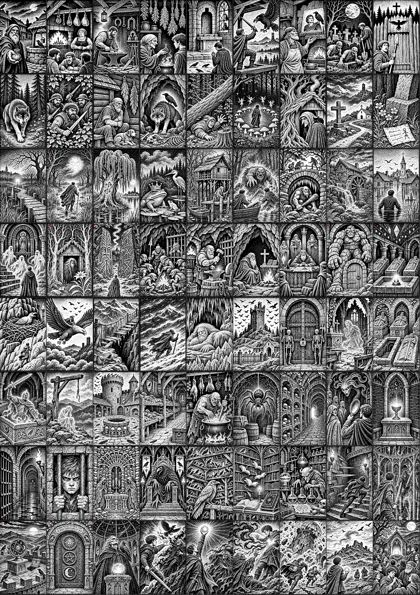

# A Varjútorony ura – kalandkönyv Videoton TV-Computerre (VT-DOS)

Saját „lapozós” kalandkönyv TVC-re: **413 fejezet**, kb. 175 000 karakter, **72 kép**, zene, harc, próbák,
tárgyak, mentés és visszatöltés. Lemezes változat (VT-DOS, 720K); TVC 64K-n és 64K+-on is fut.

**Videó a játékról:** [https://youtu.be/FrJeCwGuSBg](https://youtu.be/FrJeCwGuSBg)

[](https://youtu.be/FrJeCwGuSBg)



## Indítás
A kész lemezkép: [`lemez/varjutorony.dsk`](lemez/varjutorony.dsk). Csatold az emulátorhoz (pl. Ep128emu / Ep128web,
VT-DOS-szal), majd:
```
LOAD "KALAND"
```
- **Szóköz/Tűz:** indulás, lapozás, választás · **Esc:** kilépés
- **Kalandlap** (menü „Lap”): Fel = mentés, Le = visszatöltés
- A kezdőképernyőn a **Le** a mentett játékot tölti vissza.

## Mappák
| Mappa / fájl | Tartalom |
|---|---|
| `lemez/varjutorony.dsk` | a kész lemezkép |
| `kepek_eredeti/p1…p72.png` | a 72 kép eredeti méretben (zöld-fekete, a TVC-re átalakítás előtt) |
| `varjutorony/` | a könyv: fejezetek, szabályok, képek (`ill/`), képlista promptokkal (`KEPEK.md`), olvasható szöveg (`varjutorony.txt`) |
| `*.asm` | a Z80-as motor (szöveg kicsomagolás, menü, harc, szabály-bájtkód, VT-DOS lemezkezelés, zene) |
| `build.py` és társai | a fordító: szöveg tömörítése (BPE + Huffman), betűkészlet, képek, CAS-fájlok, FAT12 lemezkép |
| `harness/` | tesztkörnyezet (rtvc-alapú VT-DOS emulátoros teszt leírása) |

## Fordítás
Kell hozzá: Python 3 (Pillow, NumPy) és [sjasmplus](https://github.com/z00m128/sjasmplus).
```
SJASMPLUS=/út/a/sjasmplus python3 build.py --book varjutorony --disk
# -> build_varjutorony_disk/varjutorony.dsk
```
Ellenőrzés: `python3 varjutorony/ellenoriz.py` (elérhetőség, menük, 20 000 véletlen végigjátszás),
`python3 checkscripts.py build_varjutorony_disk` (a lefordított szabálykód).

## Képcsere
```
cd varjutorony
python3 kepcsere.py 12 uj_kep.png --neg --lagyit 2   # zöld-fekete, pontozott kép (mint a mostaniak)
python3 kepcsere.py 12 uj_kep.png                    # fekete tusrajz fehér papíron
```
A TVC 2 színű módjában a kép 240×240 képpont (a képernyőn álló 5:8 arányú); fekete betűk és rajz fehér lapon, mint egy nyomtatott könyvben.
Részletek: [`varjutorony/README.md`](varjutorony/README.md).

## Szerzők
A könyv szövege, szabályai, zenéje és a motor Claude (Anthropic) munkája a felhasználó (Catpool72) megbízásából;
a képeket a felhasználó készítette egy képalkotó MI-vel.
